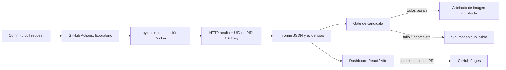

# ReleaseGuard

**¿Publicarías este cambio?** Un laboratorio personal de Diego, graduado en Ingeniería Informática, que ejecuta pruebas y controles de contenedores antes de aprobar una API mínima.

[Demo pública](https://diegomarla11.github.io/ReleaseGuard/) · [Repositorio](https://github.com/diegomarla11/ReleaseGuard) · [Informe público](https://diegomarla11.github.io/ReleaseGuard/reports/report.json) · [Informes guardados en Git](dashboard/public/reports/report.json) · [Ejecuciones y artefactos](https://github.com/diegomarla11/ReleaseGuard/actions) · [Guía de entrevista](docs/interview.md)

> Proyecto de portfolio y aprendizaje. Complementa AccessLens con automatización de pruebas, Docker, CI/CD y seguridad de dependencias. No representa experiencia profesional ni una API desplegada en infraestructura cloud. GitHub Pages sirve únicamente archivos estáticos.

## Entender la demo en un minuto

1. Intentamos publicar **ReleaseGuard Lab API 1.0.0**, una API de saludo.
2. Comprobamos pruebas, construcción de la imagen, `/health`, credenciales del proceso y vulnerabilidades con Trivy.
3. Una candidata solo se aprueba si **todos** los controles pasan. HIGH y CRITICAL bloquean, con o sin parche.
4. Compara la candidata con un `/health` que devuelve 503 y con un proceso que usa UID 0. Los fallos se miden dentro de contenedores reales; el nombre del escenario no decide el resultado.
5. Abre **Evidencias técnicas** para ver origen, fecha, commit, herramientas, imagen, ejecución y descargas originales.

**Ejecución verificada:** [29 pruebas y los tres casos reales en GitHub Actions](https://github.com/diegomarla11/ReleaseGuard/actions/runs/42258176332). Candidata aprobada; HTTP 503 y UID 0 bloqueados por sus controles respectivos. La [remediación inicial](docs/remediation.md) conserva un bloqueo real de Trivy y el cambio de base que lo corrigió. Consulta [la verificación de entrega](docs/verification.md) para el commit analizado, las herramientas, la publicación y los límites de lo comprobado. Los informes en Git son una instantánea real; CI genera una nueva al publicar Pages.

## Arquitectura



El laboratorio afirma expectativas exactas por separado del gate de la aplicación. Un caso defectuoso detectado correctamente puede tener una **aserción de laboratorio superada** y una **decisión de aplicación bloqueada**. Un error extra, una candidata bloqueada o un escaneo no ejecutado hace fallar el laboratorio. Aun así, su evidencia puede publicarse desde `main`.

No existe un registry público ni un servicio público de API. El máximo paso de publicación de la aplicación en este MVP es conservar su imagen aprobada como artefacto de Actions; los targets defectuosos nunca se exportan. El job de Pages no ejecuta código del repositorio: solo despliega el artefacto estático generado en otro job.

## Ejecución local reproducible

Requisitos: Python **3.13**, Node **22.22.3** (o compatible con Vite), Docker Engine con daemon activo y Trivy **0.76.2**. Las versiones y hashes consultados están en [toolchain.json](docs/toolchain.json). Usa un entorno de pruebas, sin secretos montados.

```bash
python3.13 -m venv .venv
source .venv/bin/activate
python -m pip install --require-hashes -r requirements-dev.txt
python -m pytest -q

# Comprobar disponibilidad real
docker info
trivy --version

# Linux x86_64: instalador oficial fijado y con SHA-256 comprobado
bash scripts/install_trivy.sh
export PATH="$PWD/.tools:$PATH"

# Cada ejecución exige una carpeta nueva para no reutilizar informes antiguos.
python -m scripts.run_lab --output artifacts/run-001
# Puede devolver 1: examina siempre el informe. No ocultes el código de salida.
python -m scripts.export_dashboard artifacts/run-001 dashboard/public/reports

cd dashboard
npm ci
npm run build
npm run dev
```

En macOS instala Docker y la distribución oficial de [Trivy para tu plataforma](https://trivy.dev/latest/getting-started/installation/), comprobando el checksum de la release fijada. No se instala un daemon ni una VM automáticamente. Si falta Docker o Trivy, el runner registra los controles no ejecutados, escribe evidencia cuando alcanza esa fase y termina con error. Un fallo previo de instalación en Actions también falla el job; no se publica evidencia antigua como si fuera nueva.

Para probar la API sin contenedor:

```bash
python -m uvicorn api.main:app --host 127.0.0.1 --port 8000
curl --fail http://127.0.0.1:8000/health
curl --fail 'http://127.0.0.1:8000/api/greet?name=Diego'
```

Para construir manualmente la candidata:

```bash
docker build --target runtime -t releaseguard:candidate .
docker run --rm --read-only --cap-drop=ALL \
  --security-opt no-new-privileges:true \
  --publish 127.0.0.1:8000:8000 releaseguard:candidate
```

El runner no expone puertos: consulta HTTP mediante `docker exec`, en una red `none`. Los procesos tienen filesystem de solo lectura, capacidades eliminadas, `no-new-privileges`, límites de CPU/memoria/PIDs y un `/tmp` efímero. El caso UID 0 también tiene esas restricciones, pero sigue incumpliendo la política de usuario. Docker comparte kernel: no equivale a una VM ni constituye aislamiento perfecto.

## Casos y mediciones

| Caso | Docker target | Cambio introducido | Medición requerida | Decisión esperada si los demás controles pasan |
| --- | --- | --- | --- | --- |
| Candidata | `runtime` | API normal, `USER 10001:10001` | HTTP 200, JSON correcto, Docker healthy, UID no cero, scan aceptable | Aprobada |
| Fallo de salud | `broken-health` | Módulo de laboratorio devuelve HTTP 503 | HTTP 503 y Docker unhealthy | Bloqueada |
| Usuario privilegiado | `root-user` | `USER 0:0` | UIDs de `/proc/1/status` contienen cero | Bloqueada |

El `Dockerfile` termina en `runtime`, por lo que la construcción por defecto es la candidata. El módulo de fallo no se copia a esa imagen. La base está fijada por digest; las dependencias Python transitivas están fijadas con hashes; npm usa `package-lock.json` y `npm ci`. La resolución de la base es reproducible, pero la base de vulnerabilidades de Trivy evoluciona: **la candidata no tiene una aprobación garantizada**. Si queda bloqueada, se actualiza la base/dependencias, se revisa el cambio y se repite; no se relaja la política para ponerla en verde.

## Seguridad y evidencia

Consulta [la política detallada](docs/security-policy.md) y [el contrato de informes](docs/report-format.md).

- Trivy escanea paquetes del sistema y de Python con `--scanners vuln`, exporta JSON completo y conserva todos los niveles. No se usa `--ignore-unfixed` ni `.trivyignore`.
- El motor evalúa HIGH y CRITICAL a partir del JSON. Un error de Trivy, JSON inválido, imagen sin inventario reconocible o ausencia de resultados nunca produce aprobación.
- `LOW`, `MEDIUM` y `UNKNOWN` permanecen visibles, aunque no bloqueen esta política inicial. Superar la política **no demuestra ausencia de vulnerabilidades** ni ausencia de defectos de lógica.
- Actions usa `contents: read`, checkout sin credenciales persistidas y acciones fijadas por SHA. Los PR usan `pull_request`, sin secretos ni publicación. No hay `pull_request_target`, encadenamiento privilegiado de `workflow_run` ni runner propio.
- Solo el job de despliegue de evidencia en `main` recibe `pages: write` e `id-token: write`; no hace checkout ni instala dependencias. Protege `main` y limita el environment `github-pages` a esa rama.
- No se envían tokens al frontend. Elegir un escenario es una operación local de React; no dispara workflows ni contenedores.

## Publicar en GitHub Pages

1. Repositorio público gratuito: `diegomarla11/ReleaseGuard`. Fuente en rama `main`.
2. En **Settings → Pages → Build and deployment → Source**, elegir **GitHub Actions**.
3. En **Settings → Environments → github-pages**, permitir despliegues solo desde `main`.
4. Hacer push o lanzar **Actions → ReleaseGuard → Run workflow** en `main`.
5. Comprobar los jobs **Laboratory expectations**, **Application release gate**, **Build evidence dashboard** y **Publish evidence, never the laboratory API**. Un gate rojo no impide mostrar el diagnóstico, pero no exporta una candidata bloqueada.
6. Verificar la URL devuelta por `deploy-pages` y abrir su `reports/report.json`. No afirmar que está publicada solo porque el código del workflow existe.

Los artefactos de evidencia caducan a los 30 días y la imagen aprobada a los 7. La última evidencia desplegada permanece en Pages hasta el siguiente despliegue. Si una ejecución falla antes de generar informe, Pages conserva la anterior **con su fecha y commit originales**; no significa que el último commit haya pasado.

## Estructura

```text
api/                  API mínima de laboratorio
laboratory/           Inyección aislada del fallo HTTP
scripts/              Ejecución, política, exportación y gate
tests/                Contratos, política, sondas e integridad
.github/workflows/    Laboratorio + gate + publicación de evidencia
dashboard/            React + TypeScript + Vite e informes guardados
docs/                 Política, formato, decisiones y verificación
```

## Límites y siguientes pasos

No hay disponibilidad de producción, despliegue cloud de API, firma de artefactos, registro de imágenes, persistencia, autenticación, Kubernetes, Terraform ni múltiples servicios. Las sumas SHA-256 detectan cambios accidentales: quien puede modificar código e informes puede recalcularlas. La cadena de suministro depende de GitHub, PyPI, npm, Docker Hub y la base de Trivy. Las acciones fijadas pueden contener dependencias transitivas, que también requieren revisión.

Después del MVP tendría sentido incorporar revisión de dependencias, actualizaciones automáticas revisadas, SBOM y firmas/atestaciones de imágenes. Si aparece una necesidad real de ejecutar la API, se diseñaría un despliegue sencillo con rollback y gestión de secretos. Nada de eso está implementado ni se presenta como una capacidad actual.

## Referencias oficiales consultadas

Verificadas el **6 de noviembre de 2026**; versiones exactas en [toolchain.json](docs/toolchain.json).

- [FastAPI en Docker](https://fastapi.tiangolo.com/deployment/docker/) y [pruebas](https://fastapi.tiangolo.com/tutorial/testing/).
- [Dockerfile: USER y HEALTHCHECK](https://docs.docker.com/reference/dockerfile/).
- [Trivy: informes JSON](https://trivy.dev/latest/docs/configuration/reporting/), [severidad y vulnerabilidades](https://trivy.dev/latest/docs/scanner/vulnerability/) y [release fijada](https://github.com/aquasecurity/trivy/releases/tag/v0.76.2).
- [Workflows personalizados de Pages](https://docs.github.com/en/pages/getting-started-with-github-pages/using-custom-workflows-with-github-pages), [deploy-pages](https://github.com/actions/deploy-pages) y [seguridad de Actions](https://docs.github.com/en/actions/security-for-github-actions/security-guides/security-hardening-for-github-actions).
- [Vite: requisitos y uso](https://vite.dev/guide/) y [despliegue estático](https://vite.dev/guide/static-deploy.html).
